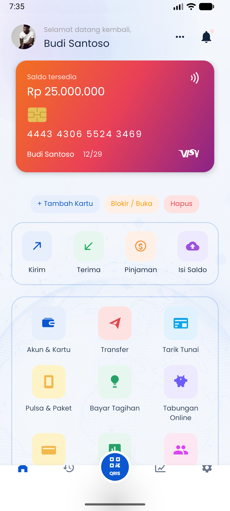
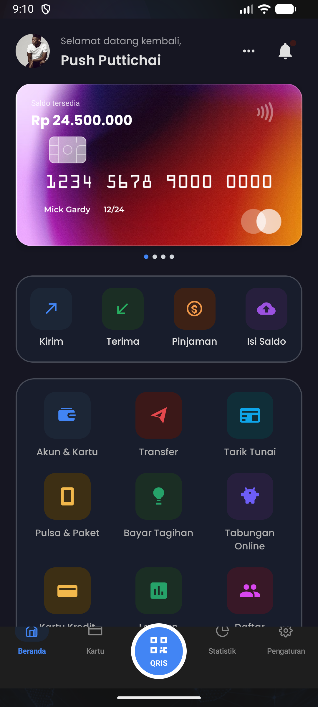
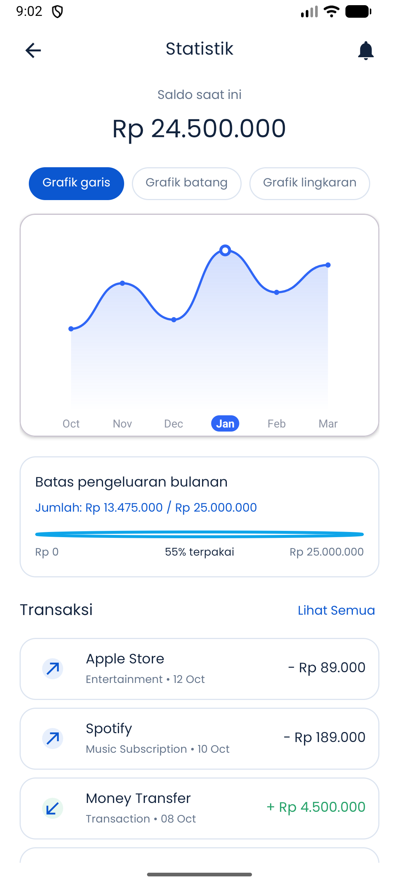
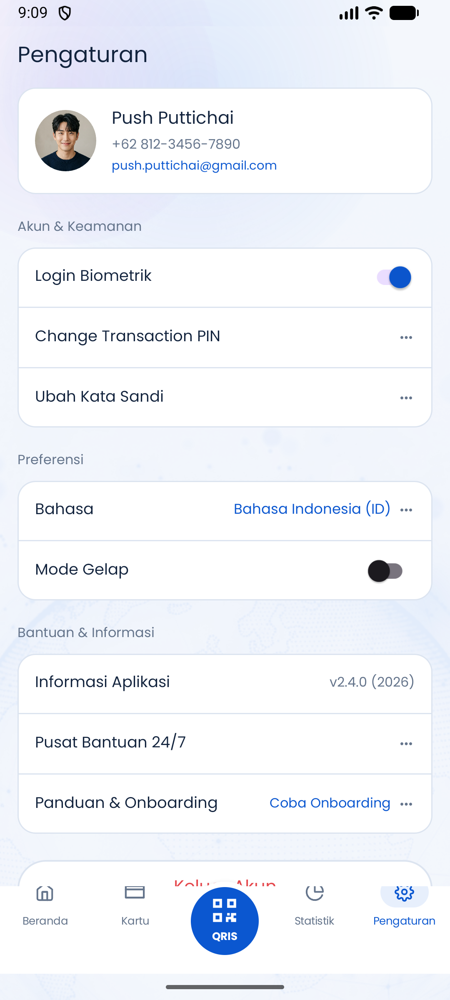
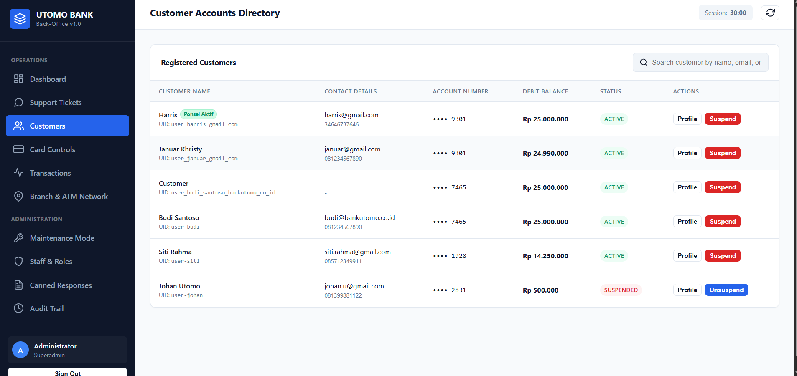
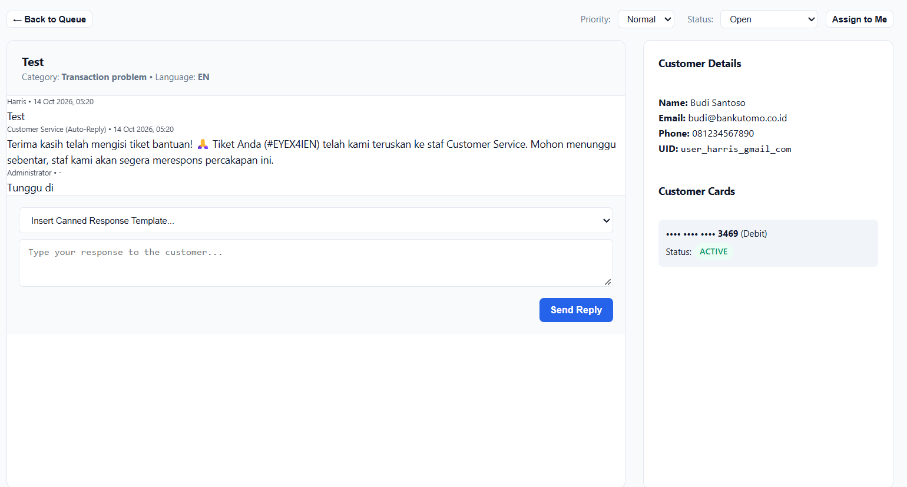

# UTOMO Bank

UTOMO Bank adalah aplikasi mobile banking Android dengan back-office web untuk pengelolaan nasabah, kartu, transaksi, tiket bantuan, dan konfigurasi sistem.

## Tampilan Aplikasi

### Mobile banking

| Home light | Home dark |
| --- | --- |
|  |  |

| Statistics | Settings |
| --- | --- |
|  |  |

### Back-office control panel

| Customer directory | Support ticket detail |
| --- | --- |
|  |  |

## Fitur Utama

- Login dan register dengan Firebase Authentication.
- Login Google dan pengaitan akun Google.
- Dashboard saldo, kartu, shortcut transaksi, dan QRIS.
- Card slider, tambah kartu, blokir/buka kartu, serta sinkronisasi status kartu.
- Transfer, top up e-wallet, pulsa, pembayaran tagihan, tarik tunai, dan riwayat transaksi.
- Currency exchange dengan saldo per mata uang.
- Statistics, grafik pengeluaran, batas pengeluaran, dan transaction report.
- Customer service 24/7 berbasis tiket dan percakapan Firestore.
- Maintenance mode dan account suspension dari control panel.
- Preferensi bahasa dan dark/light mode.

## Struktur Project

```text
app/                  Android app Kotlin/XML
admin-panel/          Web back-office SPA
functions/             Firebase Cloud Functions
scripts/               Tool provisioning role Firebase
docs/                  SQL schema dan screenshot dokumentasi
firestore.rules        Security rules Firestore
storage.rules          Security rules Cloud Storage
firebase.json          Konfigurasi Firebase CLI
```

## Teknologi

- Kotlin dan Android XML untuk aplikasi native Android.
- Firebase Authentication untuk identitas pengguna.
- Cloud Firestore untuk profil, kartu, transaksi, tiket, chat, audit, dan konfigurasi.
- Firebase Realtime Database untuk mirror status yang membutuhkan pembacaan cepat.
- Firebase Cloud Functions untuk operasi server-side dan integrasi admin.
- Firebase Storage untuk file atau avatar.
- Lottie untuk animasi JSON.
- Firebase Web SDK 10.x untuk control panel.

## Menjalankan Android App

1. Buka folder project di Android Studio.
2. Pastikan Android SDK dan JDK sesuai konfigurasi Gradle.
3. Pastikan `app/google-services.json` berasal dari Firebase project yang benar.
4. Sync Gradle, pilih emulator/perangkat, lalu jalankan konfigurasi `app`.

## Menjalankan Control Panel

Di Windows:

```bat
start-admin-panel.bat
```

Atau jalankan server statis dari folder `admin-panel`:

```bash
python -m http.server 8181
```

Login control panel menggunakan akun staff yang terdaftar di Firebase Authentication dan memiliki role Custom Claims yang sesuai.

## Firebase dan Keamanan

File service account, token, `.env`, build output, cache, screenshot QA sementara, dan helper lokal diabaikan oleh `.gitignore`. Konfigurasi client Firebase yang ada di aplikasi bukan service credential; akses tetap harus dibatasi melalui Authentication, Firestore Rules, Storage Rules, dan App Check.

Untuk membuat staff pertama, gunakan `scripts/set-staff-role.js` dengan service-account JSON lokal. File service-account tersebut tidak boleh di-commit.

Dokumentasi fitur dan teknis lengkap tersedia di:

- `DOKUMENTASI_LENGKAP_FITUR_UTOMO_BANK_TEKNIS_MENDALAM.docx`
- `DOKUMENTASI_LENGKAP_FITUR_UTOMO_BANK_TERBARU_UPDATED.docx`
- `BACKOFFICE_SETUP.md`
- `FEATURES.md`
- `docs/mysql_schema_utomo_bank.sql`
